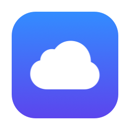

  

<h1 align="center">GitSync</h1>

<a href="README.md">English</a> · <b>简体中文</b>

把 GitHub 当作 Mac 的私人云盘：文件夹自动同步到 GitHub，多台 Mac 之间保持一致。

  <a href="https://github.com/Atonettt/GitCloudSync/releases/latest/download/GitSync.dmg"><b>⬇︎ 下载 GitSync.dmg</b></a>
  · 需要 macOS 14 或更新版本 · 支持 Apple 芯片和 Intel

## 能做什么

- **自动同步**：每隔几分钟自动上传本机修改、下载其他 Mac 的修改，在菜单栏后台运行。
- **拖进来就能用**：把任意文件夹拖进窗口，自动在 GitHub 上建一个同名私有仓库并上传。
- **历史版本**：查看、预览、恢复文件以前的版本，找回误删的文件。
- **不会覆盖文件**：两台 Mac 改了同一个文件时，会让你选择保留哪个，或者两个都留。
- **分别删除**：可以只删 GitHub 上的仓库，或只删本地文件夹，互不影响。
- **中文 / English**：「设置 › 通用 › 语言」可以选择跟随系统、简体中文或 English。

## 安装

1. 下载 [GitSync.dmg](https://github.com/Atonettt/GitCloudSync/releases/latest/download/GitSync.dmg)，双击打开，把 GitSync 拖进「应用程序」。
2. 第一次打开时，macOS 会提示「无法验证开发者」（这个应用没有付费的 Apple 签名）。点「完成」，然后打开 **系统设置 › 隐私与安全性**，在页面下方点 **「仍要打开」**。之后就能正常打开了。
3. 如果提示安装「命令行开发者工具」，点「安装」即可（GitSync 需要用到系统自带的 Git）。

## 开始使用

1. **登录 GitHub**：打开 GitSync 的「设置 › GitHub 账户」，粘贴一个令牌。
   [点这里生成令牌](https://github.com/settings/tokens/new?scopes=repo,delete_repo&description=GitSync)，页面里的权限已经选好，滑到底部点「Generate token」，复制生成的那串字符即可。
   已经装了 GitHub CLI 并登录过的话，会自动识别，不需要令牌。
2. **添加文件夹**：把文件夹拖进 GitSync 窗口。已经在 GitHub 上的仓库直接加入；普通文件夹会帮你在 GitHub 上新建仓库。
3. **打开仓库卡片右上角的「自动同步」开关**：会立即同步一次，之后每隔几分钟自动同步。新加入的仓库默认就是打开的。关掉窗口也会在菜单栏继续同步。

## 需要知道的

- 只能恢复到**同步时**的版本，两次同步之间的中间修改找不回来。
- 历史会随修改慢慢变大（Word、PPT、图片每改一次大约多存一份）。仓库卡片上会显示占用，超过 GitHub 建议的 1 GB 时会提醒，「详情」里能看到最占空间的文件。
- 单个文件不能超过 100 MB（GitHub 的限制），超过的文件会留在本地、不上传。
- 不建议把仓库放在 iCloud 同步的文件夹里（例如开启了 iCloud 的桌面和文稿），两边同时同步可能出问题。

---

开发、编译和实现细节见 [Docs/开发说明.md](Docs/开发说明.md)，更新记录见 [CHANGELOG.md](CHANGELOG.md)。
